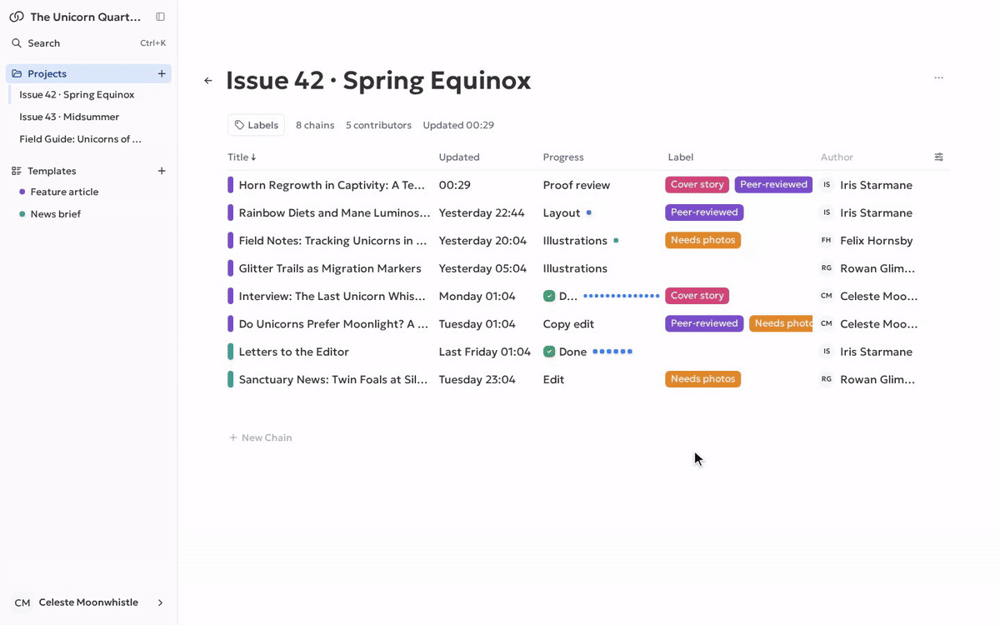
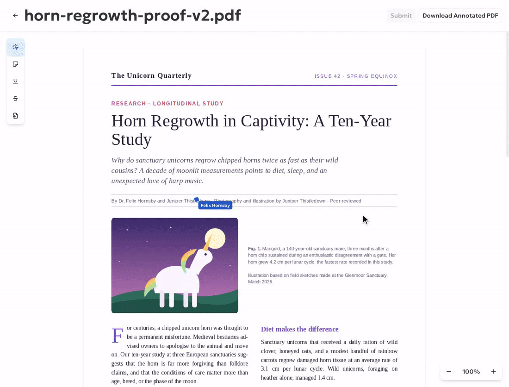

# Hi, I'm Andrey 👋

Product engineer in Barcelona. I build TypeScript products end to end, from UX to architecture to production. Before software I was a graphic designer, and it shows in how I build interfaces.

## What I'm building: [Chains](https://chains.design)

A multi-tenant workflow SaaS for editorial and design teams. It has been in production with an external pilot team for two years. The source is private, but I'm happy to give a live walkthrough.

**Workflow builder and live runtime.** A template defines the DAG (parallel branches, merge points, role-based executors). Each chain moves through it as teammates commit and approve, and the page updates in real time.

**Collaborative PDF review.** Reviewers mark up the proof together: notes, underlines, and strikethroughs, with teammates' live cursors on the page.

Demo data: a fictional journal of unicorn studies.

**Highlights**
- **Visual DAG workflow builder:** templates, parallel branches, merge points, and role-based actions. A server-authoritative runtime derives status and permissions from commits and approvals.
- **Real-time collaborative PDF review:** virtualized rendering, presence and cursors, optimistic annotations reconciled over Socket.IO, version-aware snapshots.
- **Explicit state architecture:** TanStack Query owns server data and Zustand owns interaction state. Ownership rules are documented and enforced with import-boundary checks.
- **Quality and delivery:** 350+ test files across unit, PostgreSQL-backed integration, and Playwright full-stack E2E tests. CI runs only on affected paths, and deploys use Docker, GitHub Actions, and health checks.

- **Browser extension:** an MV3 extension built with WXT and published in the [Chrome Web Store](https://chromewebstore.google.com/detail/chains/oahpcehkkamiegnlkafmondpcifenefm).

**Stack:** TypeScript · React · Vite · TanStack Query · Zustand · NestJS · PostgreSQL · TypeORM · Supabase · Socket.IO · Astro · WXT (MV3) · Vitest · Playwright · Docker

## How I work
AI-native: I write specs, drive coding agents, and own the architecture, the review, and the verification. Every change goes through tests and quality gates before it ships.

## Contact
[CV (PDF)](Andrey_Kovlyagin_CV.pdf) · [LinkedIn](https://www.linkedin.com/in/andrey-kovlyagin) · andrey.kovlyagin@gmail.com · Open to product engineer / frontend / full-stack roles in Barcelona or remote from Spain.
